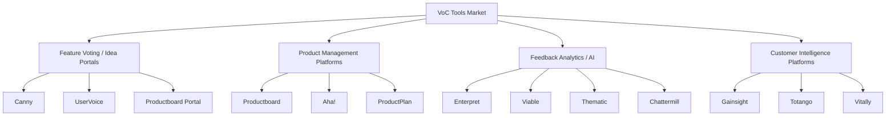

# Competitive Analysis
## Voice of Customer Copilot

---

### Market Landscape

---

### Direct Competitors (Feedback Analytics / AI)

#### 1. Enterpret
**Positioning:** "AI-powered customer feedback analytics for product teams"
**Pricing:** ~$2,000-5,000/month (enterprise)
**Strengths:**
- Strong NLP/theme modeling
- Snowflake/BigQuery integration
- Slack/Intercom/Zendesk connectors
- Custom taxonomy support

**Weaknesses:**
- High price point (excludes SMB/mid-market)
- Complex setup (weeks, needs data engineering)
- Black-box AI — limited explainability
- No prioritization framework built-in
- Overkill for teams <20 PMs

**Differentiation Opportunity:** VoC Copilot = 10x faster setup, 10x lower cost, transparent reasoning, built-in prioritization

#### 2. Viable (acquired by Pendo)
**Positioning:** "GPT-powered qualitative analysis"
**Pricing:** Was ~$1,500/month (now part of Pendo)
**Strengths:**
- Natural language queries
- Good quote extraction
- Automated weekly reports

**Weaknesses:**
- Now locked into Pendo ecosystem
- Limited customization
- No revenue impact quantification
- No decision tracking

#### 3. Thematic
**Positioning:** "Thematic analysis of customer feedback at scale"
**Pricing:** ~$3,000+/month
**Strengths:**
- Academic-grade thematic analysis
- Multi-language support
- Strong visualization

**Weaknesses:**
- Researcher-focused, not PM-focused
- No product prioritization features
- Expensive, annual contracts only

#### 4. Chattermill
**Positioning:** "Unified customer intelligence platform"
**Pricing:** Enterprise only ($50k+/year)
**Strengths:**
- Omnichannel ingestion
- Strong CX metrics (NPS, CSAT drivers)
- Executive dashboards

**Weaknesses:**
- CX-focused, not product-focused
- Very expensive
- Long implementation

---

### Adjacent Competitors (PM Platforms with Feedback Features)

#### 5. Productboard
**Positioning:** "Product management platform for customer-centric teams"
**Pricing:** $20-80/user/month → ~$2,500/month for team of 5
**Feedback Features:**
- Portal + email ingestion
- Basic tagging/hierarchy
- User impact scoring (manual)
- Roadmap integration

**Gaps vs VoC Copilot:**
- No AI theme clustering
- Impact scoring is manual guesswork
- No revenue quantification
- No AI assistant for ad-hoc queries
- Expensive for feedback-only use case

#### 6. Aha!
**Positioning:** "Product development software"
**Pricing:** $59-149/user/month
**Feedback Features:**
- Ideas portal
- Basic categorization
- Scorecards (customizable)

**Gaps:**
- No AI analysis
- Feedback is secondary to roadmap features
- Rigid workflows

#### 7. Pendo
**Positioning:** "Product experience platform"
**Pricing:** $2,000+/month (starts high)
**Feedback Features:**
- In-app guides + feedback
- Viable integration (recent)
- Product analytics + feedback correlation

**Gaps:**
- Analytics-first, feedback-second
- Expensive
- Complex for pure feedback analysis

---

### Low-End Competitors (Idea Portals)

#### 8. Canny
**Positioning:** "Customer feedback management"
**Pricing:** $400/month (growth plan)
**Features:**
- Public portal + widget
- Voting + comments
- Basic tags + status
- Changelog

**Gaps:**
- No AI analysis
- Public-facing only (not internal feedback)
- No prioritization framework
- No revenue impact

#### 9. UserVoice
**Positioning:** "Product feedback software"
**Pricing:** $999+/month
**Features:**
- Forum + widget
- SmartVote (priority algorithm)
- Basic reporting

**Gaps:**
- Dated UX
- Limited AI
- Expensive for features

---

### Competitive Comparison Matrix

| Capability | VoC Copilot | Enterpret | Productboard | Canny | Pendo |
|------------|-------------|-----------|--------------|-------|-------|
| **AI Theme Clustering** | ✅ Rule-based + keywords | ✅ Advanced ML | ❌ Manual tags | ❌ | ⚠️ Via Viable |
| **Revenue Impact Quantification** | ✅ Core feature | ❌ | ⚠️ Manual | ❌ | ❌ |
| **Evidence Traceability** | ✅ First-class | ✅ Good | ⚠️ Partial | ⚠️ | ✅ |
| **Prioritization Framework** | ✅ Impact×Frequency + RICE | ❌ | ⚠️ Custom | ❌ | ❌ |
| **AI Chat Assistant** | ✅ Core feature | ❌ | ❌ | ❌ | ❌ |
| **Decision Log** | ✅ Built-in | ❌ | ⚠️ Notes | ❌ | ❌ |
| **Setup Time** | **Minutes** | Weeks | Days | Hours | Weeks |
| **Price (Team of 5)** | **<$200/mo target** | $2,000+/mo | $2,500/mo | $400/mo | $2,000+/mo |
| **Data Privacy** | ✅ Local/controlled | ⚠️ Cloud AI | ✅ | ✅ | ⚠️ |
| **Target Segment** | **SMB/Mid-market PMs** | Enterprise | All sizes | SMB | Enterprise |

---

### Competitive Positioning Statement

> **For** Product Managers at Series A-C B2B SaaS companies  
> **Who** spend 4+ hours/week manually analyzing fragmented customer feedback  
> **VoC Copilot** is an **AI-powered feedback intelligence platform**  
> **That** auto-clusters feedback into themes, quantifies revenue impact, and generates prioritized recommendations with evidence  
> **Unlike** Enterpret ($2k+/mo, weeks to implement) or Productboard ($2.5k/mo, manual tagging)  
> **We** deliver **instant setup, transparent reasoning, built-in prioritization, and 10x lower cost**

---

### Win/Loss Analysis (Hypothetical)

| Scenario | Why We Win | Why We Lose |
|----------|------------|-------------|
| **Team of 3-10 PMs, $5-50M ARR** | Price, speed, PM-focused UX | Need custom taxonomy, SSO |
| **Enterprise (50+ PMs)** | — | No SSO, no audit logs, no dedicated CSM |
| **Consumer/B2C PM** | — | Wrong feedback sources, metrics |
| **Budget-conscious startup** | Free tier potential, low cost | May prefer free Notion/Sheets |
| **Research-heavy team** | — | Needs qualitative coding, not prioritization |

---

### Pricing Strategy

| Tier | Target | Price | Key Features |
|------|--------|-------|--------------|
| **Free** | Individual PMs, APMs | $0 | 50 feedback items, 3 themes, basic dashboard |
| **Pro** | Small teams (3-8 PMs) | $150/mo | Unlimited feedback, all themes, AI assistant, RICE, export |
| **Team** | Mid-market (8-25 PMs) | $500/mo | Multi-workspace, SSO, API, custom themes, dedicated support |
| **Enterprise** | Large org (25+ PMs) | Custom | On-prem, audit logs, SLA, custom ML models, CSM |

---

### Moat Building (Post-MVP)

1. **Data Network Effects:** More feedback → better theme models → better recommendations
2. **Workflow Integration:** Deep Linear/Jira/GitHub integration → switching cost
3. **Benchmarking:** Anonymized cross-customer benchmarks ("your reliability score: 40th percentile")
4. **Community Templates:** Shared prioritization frameworks, decision log templates
5. **Proprietary Taxonomy:** Industry-specific theme models (FinTech, HealthTech, etc.)

---

*Analysis date: Jan 2024 | Next update: Quarterly*