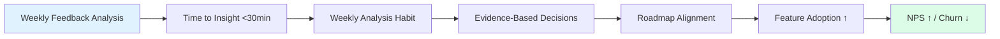

# Product Hypothesis
## Voice of Customer Copilot

### Core Hypothesis

> **If** we provide Product Managers with an AI-powered tool that automatically clusters qualitative customer feedback into themes, quantifies pain points by frequency and impact, and generates prioritized recommendations with evidence, **then** PMs will make faster, more confident product decisions backed by customer voice, **resulting in** higher feature adoption, improved NPS, and reduced churn.

---

### Sub-Hypotheses

#### H1: Analysis Speed
> **If** feedback analysis time drops from 4+ hours to <30 minutes, **then** PMs will analyze feedback weekly instead of quarterly.

**Validation:** Track time-to-insight via user surveys and usage analytics.
**Success Criteria:** 80% of users report >50% time savings.

#### H2: Decision Quality
> **If** recommendations include direct customer quotes and quantified impact, **then** PMs will justify roadmap decisions with customer evidence 3x more often.

**Validation:** Compare decision logs before/after tool adoption.
**Success Criteria:** 70% of high-priority decisions reference VoC Copilot insights.

#### H3: Prioritization Alignment
> **If** the Impact×Frequency matrix visualizes trade-offs, **then** PMs will prioritize high-impact/high-frequency items over loud-but-low-impact requests.

**Validation:** Analyze roadmap changes pre/post adoption.
**Success Criteria:** >60% of roadmap items map to "Do Now" quadrant.

#### H4: Cross-functional Alignment
> **If** insights are shareable and evidence-backed, **then** Engineering, Design, and Leadership will align faster on priorities.

**Validation:** Stakeholder survey on alignment speed.
**Success Criteria:** 50% reduction in priority debate meetings.

#### H5: Feedback Loop Closure
> **If** PMs can trace shipped features back to specific feedback, **then** they'll close the loop with customers more consistently.

**Validation:** Track customer follow-up actions.
**Success Criteria:** 40% of addressed feedback items get customer follow-up.

---

### Assumptions to Test

| Assumption | Risk Level | Test Method |
|------------|------------|-------------|
| PMs trust AI-generated themes | High | User testing with think-aloud protocol |
| 11 predefined themes cover 90% of feedback | Medium | Analyze coverage on real datasets |
| Rule-based categorization is "good enough" for MVP | Medium | Compare vs manual coding on sample |
| PMs will use chat assistant regularly | High | Track assistant engagement metrics |
| Synthetic data is realistic enough for demo | Low | Expert review by 3+ PMs |

---

### Success Metrics Dashboard

---

### Falsification Criteria

**We will pivot if:**
- <30% of beta users complete a full analysis workflow within 2 weeks
- Net Promoter Score for the tool itself <30
- >50% of users say "I'd rather do it manually"
- Core workflow (Feedback → Insights → Decision) has >5 friction points

---

### Learning Goals (First 30 Days)

1. **Usability:** Where do PMs get stuck in the workflow?
2. **Trust:** Which AI outputs do they verify vs accept?
3. **Value:** Which features drive "aha!" moments?
4. **Gaps:** What real-world data sources are missing?
5. **Pricing:** What would they pay for this vs current tools?

---

*Document version: 1.0 | Owner: Product | Review: Bi-weekly*