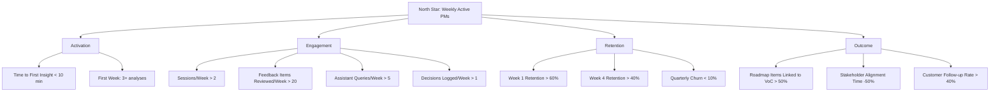

# Product Metrics
## Voice of Customer Copilot

### North Star Metric

**Weekly Active PMs Analyzing Feedback**  
*Definition: PMs who complete at least one full analysis cycle (view insights → make decision) per week*

**Target:** 60% of registered PMs WAU/MAU ratio > 0.4

---

### Metric Hierarchy



---

### Detailed Metrics Dashboard

#### 1. Acquisition Metrics

| Metric | Definition | Target | Measurement |
|--------|------------|--------|-------------|
| **Sign-ups/Week** | New workspace registrations | 50/week | Auth events |
| **Activation Rate** | % completing first analysis in 24h | >70% | First "Insights" view + filter action |
| **Time to Value** | Median time from sign-up to first decision logged | <30 min | Timestamp diff |
| **Invite Acceptance** | % of invited team members who join | >80% | Invite → accept funnel |

#### 2. Activation Metrics (First 7 Days)

| Metric | Definition | Target | Leading Indicator |
|--------|------------|--------|-------------------|
| **Setup Completion** | Added ≥10 feedback items or connected source | >60% | Inbox item count |
| **First Insight** | Viewed Themes/Insights page | >80% | Page view |
| **First Decision** | Logged decision in Decision Log | >40% | Decision created |
| **Assistant Query** | Asked AI Assistant ≥1 question | >50% | Chat message sent |
| **Team Invite** | Invited ≥1 colleague | >30% | Invite sent |

#### 3. Engagement Metrics (Ongoing)

| Metric | Definition | Healthy Range | Action if Below |
|--------|------------|---------------|-----------------|
| **Weekly Sessions** | Unique days with activity/week | 2-4 | Re-engagement email |
| **Session Duration** | Median active time | 15-45 min | Simplify workflows |
| **Feedback Reviewed** | Items opened/week | >20 | Improve filtering |
| **Themes Explored** | Unique theme pages visited | >3 | Better theme discovery |
| **Assistant Queries** | Chat messages/week | >5 | Promote assistant |
| **Decisions Logged** | Decisions/week | >1 | Simplify decision log |
| **Export/Share Actions** | PDF/CSV/link shares/week | >0.5 | Add share buttons |

#### 4. Retention Metrics

| Cohort | Week 1 | Week 2 | Week 4 | Week 12 | Target |
|--------|--------|--------|--------|---------|--------|
| **All Users** | 60% | 50% | 40% | 30% | >40% W4 |
| **Power Users** (≥3 sessions/wk) | 85% | 80% | 75% | 70% | >70% W12 |
| **Teams (3+ PMs)** | 75% | 70% | 65% | 60% | >60% W12 |
| **Enterprise Trial** | 70% | 65% | 60% | 50% | >50% W12 |

**Churn Signals:**
- 0 sessions in 14 days → "We miss you" email
- 0 decisions in 30 days → "New insights available" notification
- Team size drops → CSM outreach

#### 5. Outcome Metrics (Business Impact)

| Metric | Definition | Target | Measurement Method |
|--------|------------|--------|-------------------|
| **Roadmap Linkage** | % roadmap items with VoC Copilot evidence | >50% | Jira/Linear integration + manual survey |
| **Decision Speed** | Time from feedback cluster → logged decision | <2 weeks | Decision log timestamps |
| **Stakeholder Alignment** | Meetings to align on priority | -50% vs baseline | Quarterly survey |
| **Customer Follow-up** | % addressed feedback with customer response | >40% | CRM integration + survey |
| **Feature Adoption** | Adoption rate of features prioritized via VoC | >60% | Product analytics |
| **NPS Impact** | NPS change for cohorts with VoC-informed features | +10 pts | NPS surveys |

---

### Metric Instrumentation Plan

#### Events to Track (Client-side)

```typescript
// Core workflow events
'feedback_added'           // { source, theme_count, is_demo }
'feedback_filtered'        // { filters_applied, result_count }
'insights_viewed'          // { page: 'overview'|'themes'|'opportunities' }
'theme_explored'           // { theme, pain_points_viewed }
'opportunity_reviewed'     // { opportunity_id, priority }
'matrix_interaction'       // { quadrant, opportunity_clicked }
'recommendation_viewed'    // { recommendation_id, priority }
'decision_logged'          // { recommendation_id, action: 'approve'|'defer'|'reject', rationale }
'assistant_query'          // { query_type, response_time_ms, sources_returned }
'assistant_feedback'        // { helpful: boolean }
'export_initiated'         // { format: 'pdf'|'csv', page }
'share_initiated'          // { type: 'link'|'embed', recipient_count }
```

#### User Properties

```typescript
{
  'workspace_size': number,
  'plan': 'free' | 'pro' | 'team' | 'enterprise',
  'role': 'pm' | 'senior_pm' | 'group_pm' | 'vp_product' | 'other',
  'company_stage': 'seed' | 'series_a' | 'series_b' | 'series_c' | 'enterprise',
  'feedback_volume_monthly': number,
  'primary_sources': string[],
  'onboarding_completed': boolean,
  'first_value_date': timestamp,
}
```

---

### Dashboard Views

#### 1. Executive Dashboard (VP Product)
- North Star trend (12 weeks)
- Team adoption heatmap
- Outcome metrics (roadmap linkage, decision speed)
- Churn risk accounts

#### 2. PM Dashboard (Individual)
- Personal activity streak
- Time saved estimate (vs manual)
- Decisions made this quarter
- Top themes for owned area
- Assistant usage

#### 3. Team Dashboard (Group PM)
- Team adoption % 
- Shared decisions count
- Coverage: % feedback sources connected
- Upcoming decisions needing input

---

### Experimentation Framework

| Hypothesis | Experiment | Success Metric | Minimum Detectable Effect |
|------------|------------|----------------|---------------------------|
| **Onboarding video → faster activation** | A/B: video vs interactive | Time to first decision | -30% |
| **Daily digest email → retention** | A/B: digest vs none | Week 4 retention | +10% |
| **Assistant proactive suggestions → engagement** | A/B: proactive vs reactive | Queries/week | +50% |
| **Decision log templates → decision logging** | A/B: template vs blank | Decisions/week | +100% |
| **RICE calculator → prioritization quality** | A/B: with vs without | Stakeholder alignment score | +20% |

---

### Reporting Cadence

| Report | Audience | Frequency | Owner |
|--------|----------|-----------|-------|
| **Daily Pulse** | Slack #product-metrics | Daily 9am | Analytics |
| **Weekly Deep-dive** | Product team meeting | Weekly Monday | PM |
| **Monthly Business Review** | Leadership | Monthly 1st week | PM + Analytics |
| **Quarterly OKR Review** | Board/Investors | Quarterly | VP Product |

---

### Alerting Thresholds

| Metric | Warning | Critical | Action |
|--------|---------|----------|--------|
| **Daily Active Users** | -20% WoW | -30% WoW | Investigate outage/bug |
| **Activation Rate** | <50% | <30% | Review onboarding funnel |
| **Week 4 Retention** | <35% | <25% | User interviews + fix |
| **Decision Log Rate** | <0.5/week/PM | <0.2/week/PM | Simplify decision flow |
| **Assistant Error Rate** | >5% | >10% | Check AI service |

---

*Metrics framework v1.0 | Review monthly | Owner: Product + Analytics*