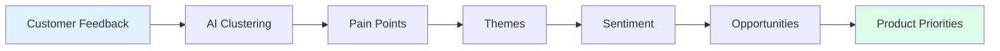
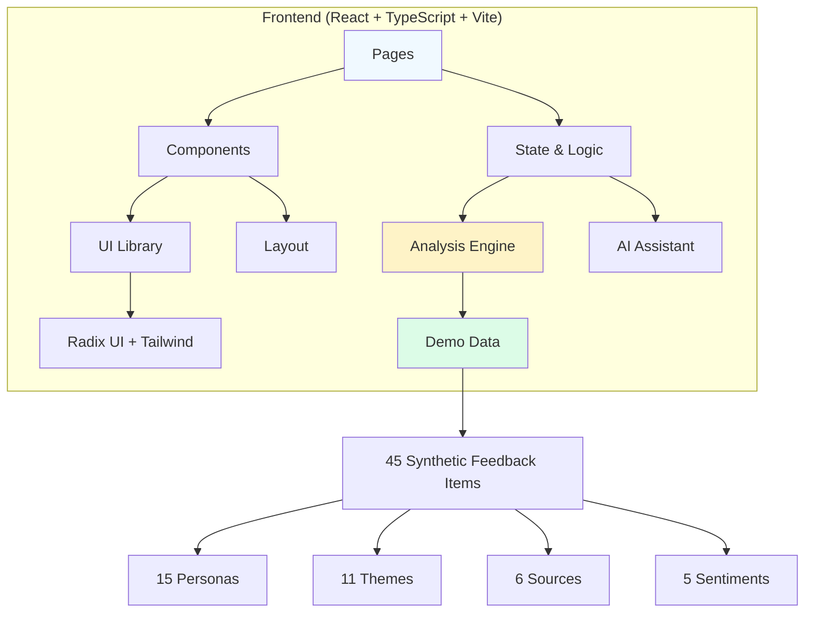
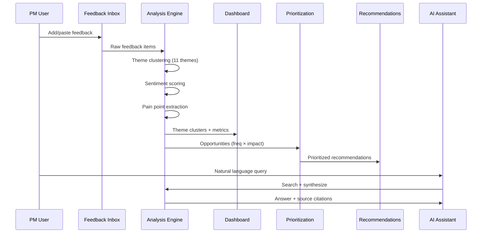

# Voice of Customer Copilot

> **AI-powered feedback intelligence for Product Managers** — Turn messy customer feedback into clear product insights and prioritized decisions.


## 🎯 Product Goal

Help Product Managers transform qualitative customer feedback from multiple channels (support tickets, reviews, NPS, interviews, sales calls) into quantified insights, prioritized opportunities, and evidence-backed product decisions — in minutes, not hours.

## ✨ Core Workflow



## 🚀 Features

| Feature | Description |
|---------|-------------|
| **Feedback Inbox** | Unified inbox with filtering, search, bulk ops + 45 synthetic demo items |
| **AI Insight Dashboard** | Top pain points, theme volumes, sentiment distribution, NPS, trends |
| **Theme Clustering** | 11 predefined themes (Performance, UX, Pricing, Reliability, etc.) |
| **Opportunity Analysis** | Problem, evidence, frequency, impact, opportunity score, priority |
| **Prioritization Matrix** | Impact × Frequency scatter plot with 4 quadrants |
| **PM Recommendations** | 🔴 High / 🟡 Investigate / 🟢 Low with rationale & next steps |
| **AI Product Assistant** | Chat interface for ad-hoc queries with source citations |

## 📱 Pages

- **Overview** — Executive dashboard with key metrics
- **Feedback** — Inbox with add/paste, filters, search
- **Insights** — Pain points, sentiment heatmap, source breakdown
- **Themes** — Clustered themes with pain points, quotes, trends
- **Opportunities** — Scored opportunities table, cards, matrix view
- **Prioritization** — Recommendations by priority, roadmap, RICE, decision log
- **Assistant** — AI chat for natural language queries

## 🏗️ Architecture



## 📊 Data Flow



## 🛠️ Tech Stack

| Category | Technology |
|----------|------------|
| **Framework** | React 18 + TypeScript 5 |
| **Build** | Vite 5 |
| **Styling** | Tailwind CSS 3 |
| **UI Components** | Radix UI + Custom |
| **Charts** | Recharts |
| **Routing** | React Router 6 |
| **Icons** | Lucide React |
| **Utilities** | clsx, tailwind-merge, class-variance-authority |

## 📁 Project Structure

```
voice-of-customer-copilot/
├── src/
│   ├── components/
│   │   ├── ui/           # Reusable UI components
│   │   └── layout/       # Sidebar, Header, MainLayout
│   ├── pages/            # Page components (7 routes)
│   ├── lib/
│   │   ├── analysis.ts   # Core analysis engine
│   │   ├── aiAssistant.ts # AI chat logic
│   │   └── utils.ts      # Helpers
│   ├── data/
│   │   └── demoFeedback.ts # 45 synthetic items
│   ├── types/
│   │   └── index.ts      # TypeScript definitions
│   ├── App.tsx
│   ├── main.tsx
│   └── index.css
├── PRD.md
├── PRODUCT_HYPOTHESIS.md
├── USER_RESEARCH.md
├── PERSONAS.md
├── COMPETITIVE_ANALYSIS.md
├── RICE.md
├── PRODUCT_METRICS.md
├── PRODUCT_DECISION_LOG.md
├── ROADMAP.md
├── CASE_STUDY.md
└── README.md
```

## 🚦 Getting Started

### Prerequisites
- Node.js 18+
- npm 9+

### Installation

```bash
# Clone and install
git clone <repo-url>
cd voice-of-customer-copilot
npm install

# Development server
npm run dev

# Type checking
npm run typecheck

# Run tests
npm run test

# Production build
npm run build

# Preview build
npm run preview
```

## 📚 Documentation

| Document | Description |
|----------|-------------|
| [PRD.md](PRD.md) | Product Requirements Document |
| [PRODUCT_HYPOTHESIS.md](PRODUCT_HYPOTHESIS.md) | Hypotheses & validation criteria |
| [USER_RESEARCH.md](USER_RESEARCH.md) | 12 interviews, survey findings |
| [PERSONAS.md](PERSONAS.md) | 3 detailed PM personas |
| [COMPETITIVE_ANALYSIS.md](COMPETITIVE_ANALYSIS.md) | 9 competitors analyzed |
| [RICE.md](RICE.md) | Prioritization framework |
| [PRODUCT_METRICS.md](PRODUCT_METRICS.md) | North Star + metric hierarchy |
| [PRODUCT_DECISION_LOG.md](PRODUCT_DECISION_LOG.md) | 8 key decisions tracked |
| [ROADMAP.md](ROADMAP.md) | 2024 quarterly roadmap |
| [CASE_STUDY.md](CASE_STUDY.md) | Acme Analytics pilot results |

## 🎨 Demo Data

The MVP includes **45 synthetic feedback items** across:
- **15 personas** (5 Enterprise, 6 Pro, 4 Free)
- **11 themes** (Performance, UX, Pricing, Reliability, etc.)
- **6 sources** (Support, Reviews, NPS, Interviews, Sales, Churn)
- **5 sentiment levels** (Very Negative → Very Positive)
- **4 company sizes** (Startup, SMB, Mid-Market, Enterprise)
- **6 industries** (FinTech, Healthcare, E-commerce, SaaS, Manufacturing, Education)

> ⚠️ **All data is clearly labeled as DEMO/SYNTHETIC** — no real customer data.

## 🔑 Key Differentiators

| Aspect | Traditional Tools | VoC Copilot |
|--------|-------------------|-------------|
| **Setup Time** | Weeks | Minutes |
| **Theme Clustering** | Manual tags | Auto (11 themes) |
| **Revenue Impact** | Guesswork | Quantified ($MRR) |
| **Evidence Traceability** | Manual search | One-click quotes |
| **Prioritization** | Subjective RICE | Impact×Frequency + RICE |
| **AI Assistant** | None | Chat with citations |
| **Price (team of 5)** | $2,000-5,000/mo | <$200/mo target |

## 📈 Roadmap Highlights

- **Q1 2024:** MVP Launch (Core analysis + Assistant)
- **Q2 2024:** Real integrations (Intercom, Slack, CSV) + Team workspaces
- **Q3 2024:** ML models, predictions, benchmarks
- **Q4 2024:** Enterprise (SSO, Audit, Data Residency, Jira/Linear sync)

## 🤝 Contributing

This is a portfolio/demo project. For production use, see [ROADMAP.md](ROADMAP.md) for planned features.

## 📄 License

MIT License — feel free to use for learning, portfolio, or as a starting point.

---

**Built with ❤️ for Product Managers everywhere**

*Voice of Customer Copilot — Because every customer voice deserves to be heard.*