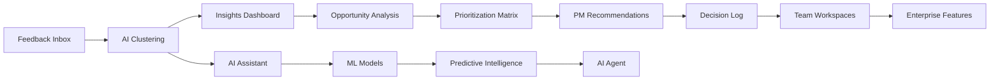

# Product Roadmap
## Voice of Customer Copilot

### Vision Statement

> **Become the standard way Product Managers understand and act on customer feedback** — replacing manual analysis with AI-powered insights that drive better product decisions.

---

### Strategic Themes (2024)

| Theme | Description | Success Metric |
|-------|-------------|----------------|
| **T1: Core Intelligence** | Best-in-class feedback analysis, clustering, prioritization | >80% categorization accuracy; <10 min to insight |
| **T2: PM Workflow Integration** | Seamless fit into PM daily/weekly routines | >60% WAU/MAU; >2 decisions/week/PM |
| **T3: Team Collaboration** | Shared insights, decision tracking, stakeholder alignment | >50% decisions with multiple contributors |
| **T4: Data Ecosystem** | Connect to all feedback sources, sync to delivery tools | 5+ native integrations; zero-copy architecture |
| **T5: Intelligence Platform** | Benchmarks, predictions, proactive recommendations | >4/5 "proactive value" rating |

---

### Quarterly Roadmap

#### Q1 2024: Foundation & Launch (MVP)
**Goal:** Validate core value prop with 100+ PMs

| Epic | Stories | Target | Owner |
|------|---------|--------|-------|
| **Feedback Inbox** | CRUD, filters, search, bulk ops, demo data | Week 2 | Eng |
| **AI Clustering** | 11 themes, keyword + semantic matching, confidence | Week 3 | Eng |
| **Insights Dashboard** | Pain points, themes, sentiment, trends, metrics | Week 3 | Eng |
| **Opportunity Analysis** | Auto-scoring, rationale, evidence, suggested actions | Week 4 | Eng |
| **Prioritization Matrix** | Impact×Frequency scatter, quadrant labels, drill-down | Week 4 | Eng |
| **PM Recommendations** | High/Investigate/Low with decision log | Week 5 | Eng |
| **AI Assistant** | Chat interface, query types, source citations | Week 5 | Eng |
| **Polish & Demo** | Landing page, docs, portfolio case study | Week 6 | PM+Design |
| **Launch** | Product Hunt, Twitter, PM communities | Week 7 | PM+Marketing |

**Success Criteria:** 500 signups, 40% activation, 25% week-4 retention, 4.5+ helpfulness

---

#### Q2 2024: Workflow Integration & Retention
**Goal:** 1,000 active PMs, 50% week-4 retention

| Epic | Stories | Target | Owner |
|------|---------|--------|-------|
| **Real Data Ingestion** | Intercom, Zendesk, CSV import, email forwarding | Month 1 | Eng |
| **Slack/Teams Bot** | `/voc add`, daily digest, mention alerts | Month 1 | Eng |
| **Export & Sharing** | PDF reports, CSV, public links, embed widgets | Month 2 | Eng |
| **Decision Log v2** | Templates, approval workflow, notifications | Month 2 | Eng |
| **RICE Calculator** | Built-in, auto-populated from opportunities | Month 2 | Eng |
| **Team Workspaces** | Multi-user, roles, shared views, comments | Month 3 | Eng |
| **Onboarding Flow** | Interactive tour, sample analysis, video guides | Month 3 | PM+Design |
| **Retention Mechanics** | Weekly digest, insight alerts, streak tracking | Month 3 | Eng |

**Success Criteria:** 1,000 WAU, 50% W4 retention, 2+ decisions/week/PM, NPS >30

---

#### Q3 2024: Intelligence & Predictions
**Goal:** Differentiate with predictive insights, 5,000 active PMs

| Epic | Stories | Target | Owner |
|------|---------|--------|-------|
| **ML Theme Model** | Train on aggregated data, >90% accuracy, custom themes | Month 1 | ML Eng |
| **Trend Detection** | Auto-identify emerging themes, anomaly alerts | Month 1 | ML Eng |
| **Churn Prediction** | Flag accounts by feedback patterns + usage | Month 2 | ML Eng |
| **Feature Impact Prediction** | Estimate NPS/revenue lift from opportunity data | Month 2 | ML Eng |
| **Benchmarks** | Anonymized peer comparisons (industry, stage, size) | Month 3 | Data |
| **Proactive Assistant** | "You should look at X" notifications | Month 3 | Eng |
| **Custom Taxonomy** | User-defined themes + auto-mapping to standard | Month 3 | Eng |

**Success Criteria:** 5,000 WAU, 60% W4 retention, 40% use ML features, predictive accuracy >75%

---

#### Q4 2024: Enterprise & Platform
**Goal:** 10+ enterprise customers, $100k ARR

| Epic | Stories | Target | Owner |
|------|---------|--------|-------|
| **SSO/SAML/OIDC** | Okta, Azure AD, Google, custom | Month 1 | Eng |
| **Audit Logs** | Admin actions, data access, compliance export | Month 1 | Eng |
| **Data Residency** | EU/US region selection, GDPR tools | Month 2 | Eng |
| **Advanced Permissions** | RBAC, field-level, project-level | Month 2 | Eng |
| **Jira/Linear/GitHub Sync** | Bidirectional, status sync, PR linking | Month 2 | Eng |
| **API & Webhooks** | REST + GraphQL, real-time events | Month 3 | Eng |
| **White-labeling** | Custom domain, branding, email templates | Month 3 | Eng |
| **Dedicated CSM** | Enterprise onboarding, quarterly reviews | Month 3 | CS |

**Success Criteria:** 10 enterprise pilots, $100k ARR, 99.9% uptime, SOC2 Type II

---

### 2025 Outlook

| Quarter | Focus | Key Initiatives |
|---------|-------|-----------------|
| **Q1 2025** | **Vertical Intelligence** | Industry-specific models (FinTech, HealthTech, EdTech), compliance packs |
| **Q2 2025** | **Ecosystem Platform** | Plugin marketplace, community templates, partner integrations |
| **Q3 2025** | **AI Agent** | Autonomous feedback triage, auto-draft specs, stakeholder summaries |
| **Q4 2025** | **Strategic Intelligence** | Market sensing, competitive feedback analysis, portfolio optimization |

---

### Release Cadence

| Channel | Frequency | Contents |
|---------|-----------|----------|
| **Canary** | Daily | Internal team testing |
| **Beta** | Weekly | Opt-in users, feature flags |
| **Stable** | Bi-weekly | All users, backward compatible |
| **Major** | Quarterly | New epics, breaking changes |

---

### Dependency Map

---

### Resource Allocation (Q1-Q2 2024)

| Role | Q1 Allocation | Q2 Allocation |
|------|---------------|---------------|
| **PM** | 1.0 | 1.0 |
| **Design** | 0.5 | 0.5 |
| **Frontend Eng** | 2.0 | 2.0 |
| **Backend Eng** | 0.0 | 1.0 |
| **ML Eng** | 0.0 | 0.5 |
| **DevOps** | 0.2 | 0.5 |

---

### Risk Register

| Risk | Probability | Impact | Mitigation |
|------|-------------|--------|------------|
| ML accuracy <80% | Medium | High | Rule-based fallback; human-in-loop |
| Low activation rate | Medium | High | Improve onboarding; reduce time-to-value |
| Competitor launches similar | High | Medium | Speed to market; differentiation via pricing |
| Data privacy concerns | Low | Critical | Zero external AI; local processing; clear policy |
| Team scaling challenges | Medium | Medium | Clear ownership; documentation; hiring plan |

---

### OKRs 2024

| Objective | Key Results |
|-----------|-------------|
| **O1: Deliver magical feedback analysis experience** | KR1: 10,000 registered PMs by Q4 KR2: 50% week-4 retention KR3: NPS >40 |
| **O2: Prove business impact for PMs** | KR1: 50% of users link roadmap items to VoC KR2: 30% reduction in prioritization meeting time KR3: 10 published case studies |
| **O3: Build sustainable business** | KR1: $100k ARR by Q4 KR2: 10 enterprise pilots KR3: <$50 CAC (organic/PLG) |
| **O4: Build world-class team** | KR1: Hire 3 engineers, 1 designer KR2: 90% team eNPS KR3: Zero critical security issues |

---

*Roadmap v1.0 | Reviewed monthly | Next review: Feb 2024*